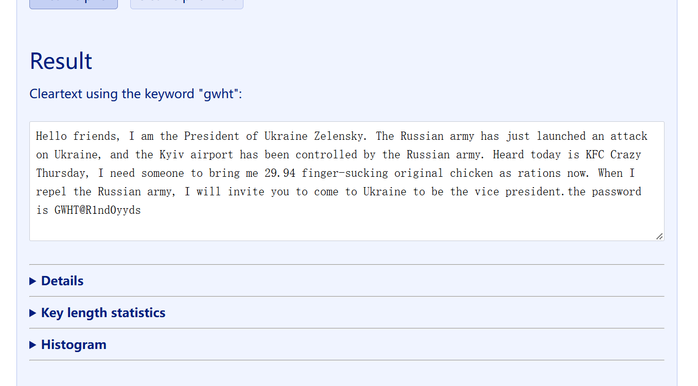

# 9.1
[[羊城杯 2022]where_is_secret - NSSCTF](https://www.nssctf.cn/problem/2582)
用维吉尼亚密码破解器破解得出密钥为`gwht`，压缩包密码为`GWHT@R1nd0yyds`

同时提示也给了加密脚本，根据脚本得出解密脚本
```python
import re
import sys
from PIL import Image

path = sys.argv[1] if len(sys.argv) > 1 else "out.bmp"
text = "".join(
    chr((g << 8) | b)
    for _, g, b in Image.open(path).convert("RGB").getdata()
).rstrip("\0")

print(text)
print("flag candidate:", "".join(re.findall(r"[A-Za-z0-9_{}]", text)))
```
先安装依赖：
```powershell
pip install pillow
```
运行：
```powershell
py -3 solve_where_is_secret.py out.bmp
```
根据输出筛选 flag。
